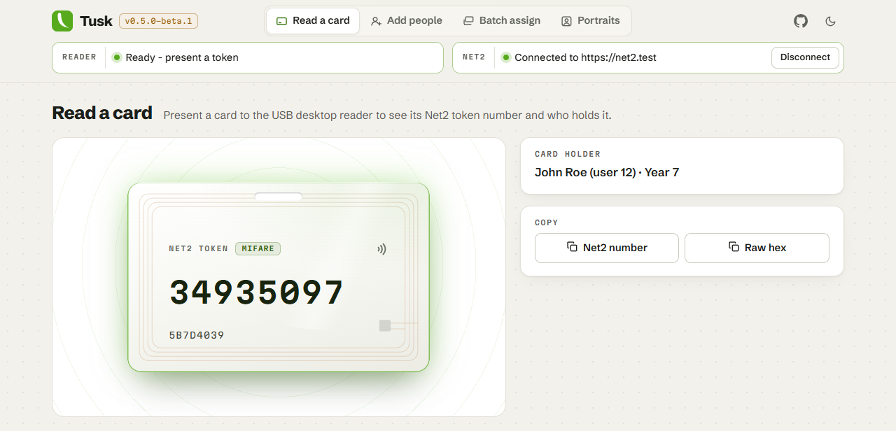
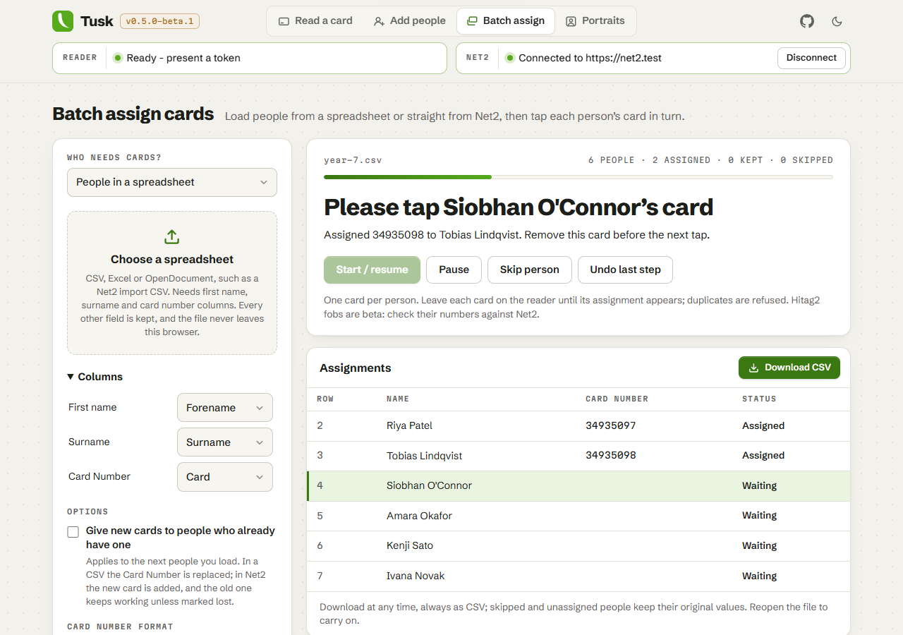
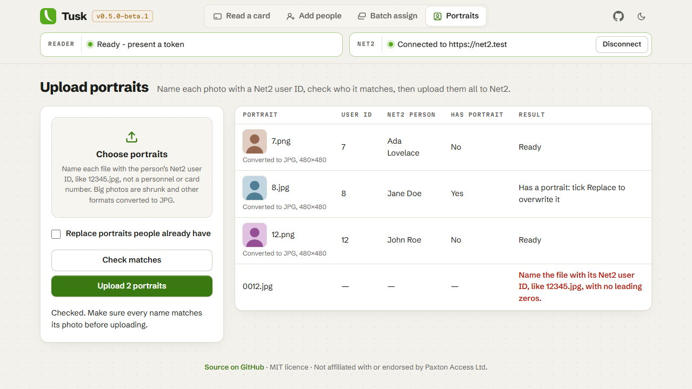
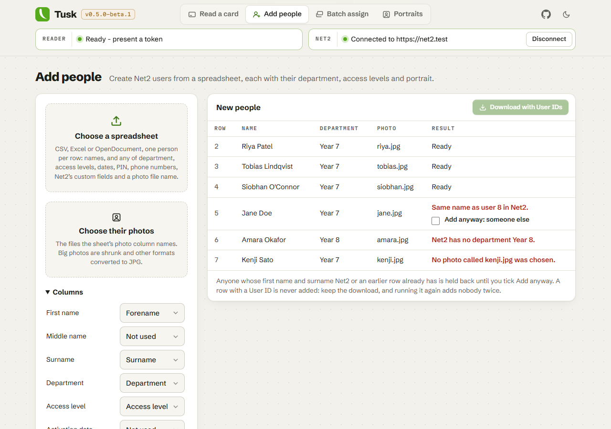

# Tusk

[](LICENSE)
[](https://www.rust-lang.org)
[](https://github.com/tokio-rs/topcoat)
[](https://developer.mozilla.org/en-US/docs/Web/API/WebHID_API)
[](https://github.com/gregorycarnegie/tusk/actions/workflows/ci.yml)

Read tokens from a Paxton Net2 USB desktop reader in the browser, over WebHID.
No drivers, no Net2 software, no server — put a card on the reader and the
token number appears, as Net2 would show it.

It can also talk to Net2 itself: add people from a spreadsheet with their
portraits, upload ID card portraits, and save each tapped card straight to the
right person, with no CSV import in between.
See [Working with Net2 directly](#working-with-net2-directly).

**Try it: <https://gregorycarnegie.github.io/tusk/>** — in Chrome or Edge,
with the reader plugged in. Nothing to install.

Tusk reads Mifare cards. Legacy 125 kHz tokens such as Paxton's Hitag2 fobs
are not supported.



The reader and Net2 connections sit under the header on every tab, and
**Sign in** there opens the Net2 sign-in from wherever you are. Light and
dark themes follow the system setting, with a toggle in the header.

The reader speaks an undocumented, lightly obfuscated HID protocol. Working it
out was most of this project; [PROTOCOL.md](PROTOCOL.md) is the write-up.

## Requirements

- **Chrome or Edge.** WebHID is not available in Firefox or Safari, and the
  page says so rather than failing silently.
- **A Paxton Net2 USB desktop reader** (`USB\VID_1071&PID_0001`).
- **On Linux, a udev rule.** Chrome reaches the reader through
  `/dev/hidrawN`, which is root-only by default, so the device either never
  appears in the chooser or fails to open. Windows needs nothing here; Linux
  needs this once:

  ```sh
  sudo tee /etc/udev/rules.d/70-paxton-net2.rules <<'EOF'
  SUBSYSTEM=="hidraw", ATTRS{idVendor}=="1071", ATTRS{idProduct}=="0001", TAG+="uaccess"
  EOF
  sudo udevadm control --reload-rules && sudo udevadm trigger --subsystem-match=hidraw
  ```

  `uaccess` grants an ACL to whoever is logged in at the active seat, the same
  mechanism udev uses for webcams.
- **Rust 1.99+** with the `wasm32-unknown-unknown` target, and
  `wasm-bindgen-cli` matching the `wasm-bindgen` version in `Cargo.lock`.

```sh
rustup target add wasm32-unknown-unknown
cargo install wasm-bindgen-cli --version 0.2.130 --locked
```

## Running

```sh
cargo run --locked -- dist
cargo build --locked --release --lib --target wasm32-unknown-unknown
wasm-bindgen --target web --no-typescript --out-dir dist target/wasm32-unknown-unknown/release/tusk.wasm
python -m http.server 8000 --directory dist --bind 127.0.0.1
```

Open <http://127.0.0.1:8000>, click **Connect reader**, and pick the device. (Not 8080 on a Net2 server:
Net2's own web server uses that port for its setup page.)
The picker shows it under an unreadable name — that is the reader returning
uninitialised memory as its USB product string, and it differs every time it
enumerates. Filtering on Paxton's vendor ID at least leaves it as the only
entry in the list.

After the first connection the browser remembers permission for that device,
so reloading reconnects without a prompt. After unplugging it, click **Connect
reader** again: the reader has no USB serial number, so Chrome forgets the
permission when it is unplugged and the page cannot reconnect by itself.

## Assign a batch of cards

Open **Batch assign cards** (or `/#batch` locally and `/tusk/#batch` on Pages).



1. Connect the reader and choose a spreadsheet: a Net2 import CSV, any CSV
   UTF-8 or tab-separated file, or the first sheet of an Excel (xlsx, xlsm,
   xlsb, xls) or OpenDocument (ods) workbook. It needs first name, surname and
   card number columns. Headings such as `Forename` or `Last name` are matched
   for you; under **Columns**, pick any column the headings do not name.
2. Existing card numbers are kept by default. To reissue cards, select
   **Replace existing card numbers** before loading the file.
3. Leave the format on **Net2 decimal**, or select **Raw card hex** before
   assigning the first card. Decimal uses the same Net2 conversion as the reader;
   hex writes the full raw hex shown by the reader. Other CSV values are unchanged.
4. Press **Start / resume**, then tap the named person's card. Wait for the
   assignment to appear before moving to the next card. A held card is accepted
   once; cards already used elsewhere in the batch are refused.
   The reader shows its token-found LED once after an assignment succeeds,
   as Net2 does. For cards saved
   directly to Net2, it waits for Net2 to confirm the save. This feedback has
   been checked on a real Paxton reader, with a local CSV assignment and with
   cards saved to a real Net2: the LED changed once Net2 confirmed the save,
   not when Net2 refused the card, and went back to idle as soon as the card
   was lifted, even after holding it for several seconds.
5. Use **Skip person** for an absent student, **Undo last step** to correct a
   mistake, and **Download CSV** to save the result for Net2's import wizard.

Download works before the queue is complete, so you can save progress. It is
always a CSV, whatever kind of file was loaded. The file
keeps its columns, order, leading zeros, Unicode, quoted/multiline fields, and
trailing empty fields; only newly assigned `Card Number` values change. CSV
quoting is normalized and rows use CRLF. Skipped/unassigned people retain their
original values. Reopen a partial download with replacement off to fill remaining
empty card numbers. The tool accepts up to 10 MB and 10,000 people per file.

Processing stays in the browser. The batch pauses on reader problems or when
switching back to **Read a card**. Unsaved work triggers a leave-page warning;
there is no persistent storage, so download regularly before closing the tab.

## Working with Net2 directly

The card holder on **Read a card**, **Add people**, **Manage**, **Upload portraits**, and the **People
already in Net2** option under **Batch assign cards** use the Net2 Local API,
signed in from the page itself: **Sign in** under the header, from any tab. Net2's
own web server allows this; nothing passes through any other server, and
the access token is held in memory only, so reloading signs you out. Tusk
asks Net2 for a refresh token too, so when the session expires mid-batch (Net2
ends sessions after 30 minutes) it renews itself instead of asking for the
password again. If Net2 grants no
refresh token, an expired session signs you out as before.

You need:

- Net2 with **LocalAPI enabled** in the Net2 Configuration Utility, and the
  Net2 Service and Net2 Nginx Service running.
- An **API licence** installed on the Net2 server, and its **ClientID**. Open
  the `.lic` file in `C:\Program Files (x86)\Paxton Access\Access Control\ApiLicences`
  and copy the value of `<Attribute name="ClientID">`. The licence's own
  `<Id>` looks similar and gives `invalid_client`. The Net2 Local API
  Configuration Utility lists the ClientID under **Licence Install →
  Activated licences**.
- A Net2 **operator** allowed to view users and edit tokens and portraits,
  entered exactly as Net2 names it. Net2's built-in engineer account is
  `System engineer`. Accounts that need a second sign-in step (MFA) are not
  supported yet.
- A browser that **trusts the Net2 server's certificate**, with the server
  entered by a name the certificate covers (`https://net2-server:8443`). On the
  Net2 server itself, `https://localhost:8443` works. Chrome may also ask to
  let the page reach devices on your local network; allow it. See
  [Trusting the Net2 certificate](#trusting-the-net2-certificate).



**Portraits.** Name each photo with the person's Net2 user ID (`12345.jpg`,
no leading zeros). A JPG of up to 3.5 MB and 40 megapixels is uploaded
exactly as it is. Anything else the browser can open (PNG, WebP, GIF, BMP,
AVIF, or a photo that is too big) is converted in the browser to a JPG, at most
1200 pixels on its longest side, and the table says so. PNGs are always
converted: Net2 accepts one but shows no picture for it. Choose the
files, press **Check matches**, and compare every name with its photo. People
who already have a portrait are skipped unless you tick **Replace portraits
people already have**. **Upload portraits** asks for confirmation; each upload
re-reads the person first and stops if they changed since the check. If a
result says Net2 did not confirm the change, look in Net2 before trying again.



**Add people.** Sign in, choose a spreadsheet with one new person per row,
and choose the photos its photo column names. Under **Columns** each Net2
field is matched to a heading: names, department, access level (one per
person, as Net2 allows), activation and expiration
dates, PIN, telephone, extension, fax, the photo's file name, a User ID, and
Net2's custom fields under the names your Net2 gives them. Dates are read as
2027-07-31, 2027-Jul-31 (as in Net2's import CSV) or 31/07/2027, day before
month; anything else is refused rather than guessed. **Check against Net2**
reads Net2's people, departments and access levels. The preview shows matched
access-level names and activation/expiry dates as year-month-day before you
confirm. Tusk sends activation at 00:00 and expiry at 23:59, but Net2 keeps
only the date; blank dates send no date.
PINs and custom fields are not shown in the preview. The check holds back a row that
already has a User ID, a department or access level Net2 does not have (Tusk
never creates one), a photo that was not chosen, and any row it cannot read.
Someone whose first name and surname Net2 already has, or an earlier row of
the sheet, is held back too, but with an **Add anyway** tick: two people can
share a name. **Add people to Net2** asks for confirmation, then creates each
person, puts them in their department, gives them their access level and
uploads their portrait, converted to a JPG when needed as for portraits.
**Download results** saves a separate CSV with the sheet row, person's name,
new User ID (when Net2 returned one), and the outcome of each attempted addition.
It includes failed department, access-level and portrait updates, and uncertain
outcomes that need checking in Net2 before retrying. It leaves out PINs and other
source columns. Results stay in this tab; closing it or replacing the sheet warns
if results have not been downloaded. Downloading results clears that warning.
**Download with User IDs** saves the sheet with each new person's User ID
filled in; load that file again and nobody is added twice. Then give out cards with **People already in
Net2** under **Batch assign cards**. Adding people is tested on a real Net2:
the person, their department, access level and portrait all arrived, and a
run of 20 people stopped after 5 and resumed from the downloaded sheet added
each person exactly once. An expiry
date arrives on the right day, and the department and access level set after
it leave it in place. Net2 stores the expiry as a date without a time; whether
a card still works on that day is not yet checked at a door.

**Manage people.** Sign in, pick a department or all users on **Manage**
and press **Show people**. Tick people, then:

- **Move to department** puts each of them in the department you choose.
- **Mark as leavers** sets their expiry to the last day you choose (Net2
  keeps the date only; whether cards still work on that day is not yet
  checked at a door), and first moves them to the leavers
  department you pick (or leaves their department as it is). Tusk reads each
  person from Net2 and sends the record back with only the expiry date
  changed. Anyone whose access already ends sooner keeps that date; marking
  a leaver never gives access back.
- **Undo a leaver** sets a new expiry for the ticked people. Leave the
  date blank to clear the expiry. Tusk reads the expiry back from Net2
  before reporting success.
- **Replace a card** saves the card on the desktop reader for one ticked
  person, then marks their other active cards lost. The card type comes
  from **Batch assign cards**.
- **Access level** sets or removes a chosen level for the ticked people.
  Net2 gives each person one access level, so setting one replaces their
  current level. Tusk keeps their individual door permissions and reads the
  set back to confirm Net2 saved it.
- **Site activity and roll call** shows the last recorded access and recent
  events for one ticked person, or an existing Net2 roll call report.
- **Assign a card tapped at a door** lets you identify an unknown card by
  its number, time and door, then assign it to one ticked person.
- **Door commands** opens one door, holds it open, or returns it to normal
  operation. Confirm the door and action before sending the command.
- **Purge expired leavers** reviews ticked people whose expiry predates the
  retention cutoff. Download the review CSV, check it, then confirm the
  permanent deletion. Tusk checks each user again before deleting their
  record and history.

**Year change**, under the same tab, is for the end of the school year. Set
the lowest and top years (7 and 13 by default) and the name the top year
becomes (`Leavers` and the year). Tusk reads Net2's departments, shows the
renames it will make, and after you confirm renames each year department one
year up, from the top down: Y13 becomes `Leavers 2027`, Y12 becomes Y13, down
to Y7 becoming Y8, then a new, empty Y7 is made. Departments named like `Y7`,
`Year 7` or `year7` count; anything else is left alone. Students stay in their
department as it is renamed, so the change is a handful of requests rather
than one per student. Start with one department per year in the selected
range. If a run stops, use the same range and leavers name to resume it.
Check that the leavers department contains the original top year when Tusk
asks you to resume. Use a separate department for mid-year leavers.
Access levels belong to each person, so a year change leaves their
permissions in place. See [TODO.md](TODO.md) for the live Net2 release checks.

If your school's MIS already syncs year groups into Net2, let it own the year
change instead: renaming keeps each department's Net2 ID.

**Card holder.** Once signed in, every card you tap on **Read a card** shows
who holds it in Net2, with their user ID and
department, and says if the card is marked lost, or that it is not in Net2.
The API has no search by card, so Tusk asks Net2's database through the API's
`customquery` endpoint with one fixed query: only the card's number goes into
it. The integration licence must allow that endpoint.

**Cards straight to Net2.** Sign in, choose **People already in Net2**, pick a
department (or all users) and press **Load people from Net2**. Each tap is
saved to that person as a Net2 decimal number. Anyone who already has a card
keeps it and is passed over, unless **Give new cards to people who already
have one** was ticked when you loaded them. In that case the new card is added
and the old one keeps working, unless **Mark their old cards lost** is ticked:
then, once the new card is saved, the person's other cards are marked lost in
Net2. The new card always goes in first, so a failure leaves them with both
cards rather than none, and the result says which old card to mark lost by
hand. People whose Net2 access has expired are listed as **Expired** and left
out of the queue. Saved cards cannot be undone from Tusk; remove them in Net2.
**Download CSV** still gives you a record with each person's Net2 user ID.

Session renewal, expiry dates and marking old cards lost are tested on a real
Net2: the old card showed as lost in Net2 and was refused at a door.

Choose the **Card type** Net2 should record, as in Net2's Change token type
dialog. It defaults to Proximity ISO card no magstripe, and the browser
remembers your choice. Net2's "Dual credential" type is not offered: the API
has no name for it. Tested on a real Net2 with the default and with Keyfob:
Net2 recorded each as chosen.

### Trusting the Net2 certificate

Net2 makes its own certificate for the Local API, so no browser trusts it until
you install it. Do this once on each computer that runs Tusk:

1. On the Net2 server, open the Net2 Local API Configuration Utility and look
   at **Certificate Import → Current Certificate** for the file's name, usually
   `Net2LocalAPI.crt`, in
   `C:\Program Files (x86)\Paxton Access\Access Control\nginx\certificate`.
   Explorer may hide the extension and show it as `Net2LocalAPI` with a
   certificate icon. Copy only that file to the other computer. The
   `Net2LocalAPI.key` beside it is the server's private key and must stay on
   the server.
2. Double-click the `.crt`, choose **Install Certificate…**, then **Local
   Machine** (every user on the computer) or **Current User** (only you).
3. Choose **Place all certificates in the following store**, **Browse…**, and
   **Trusted Root Certification Authorities**. Leaving it on *Automatically
   select* puts it where browsers ignore it. Finish, and answer **Yes** to the
   security warning. From an administrator prompt, `certutil -addstore -f Root
   Net2LocalAPI.crt` does the same for the whole computer.
4. Close every Chrome or Edge window and reopen it. The Net2 address should now
   open with no warning.

The certificate is *issued to* and *issued by* the Net2 server; that is normal
for a certificate the server made itself. Its **Details → Subject Alternative
Name** lists the addresses it covers, so enter the server by one of those.
Pressing **Regenerate** in the utility replaces the certificate, and every
computer then needs the new one installed. If your organisation has its own
certificate authority, **Import** a certificate from it instead, and domain
computers will trust it with no per-computer install.

### Sign-in problems

- **Could not reach Net2:** open the server address in a browser tab; it
  should load with no certificate warning. A VPN is a common cause: a server
  name can resolve to the VPN adapter's address, where the connection is
  dropped. On the Net2 server itself, use `https://localhost:8443`.
- **invalid_client:** Net2 does not recognise the ClientID. Check it is the
  `ClientID` attribute, not `<Id>`. After installing a licence, restart the
  Local API from the utility's **Service Controller** tab (or reboot the
  server); until then Net2 rejects the new ClientID. If it still fails, the
  licence may need a client secret, which is not in the `.lic` file; ask
  whoever issued the licence, and enter it under **Client secret**.
- **Net2 didn't accept the operator name or password:** use the name exactly
  as it appears under **Operators** in Net2, and check the same account can
  sign in to the Net2 desktop app.

## How it works

Topcoat renders the complete HTML page at build time. The browser loads a small
Rust WebAssembly module for WebHID, token decoding, and updating the controls.
Leptos and Trunk are no longer used. Topcoat's server, router, and runtime features
are disabled: there are no server endpoints or server-backed interactions. The
Net2 tools call the Net2 Local API with `fetch`; Net2's nginx answers CORS for
any origin, so this works from GitHub Pages as well as locally.

Topcoat 0.12.1 does not yet provide a built-in static export command, so
`cargo run -- dist` renders its `view!` template to `dist/index.html`.
Re-run the three build commands above after changing the sources, then reload.
Serve or upload the resulting `dist` directory as-is. Relative asset URLs work
both at the domain root and under `/tusk/` on GitHub Pages; no base URL is needed.
The reader still needs HTTPS (or localhost) for WebHID and clipboard access.
This is a Topcoat static-template experiment, not a migration to its reactive runtime.

### Reader protocol

Messages are framed, checksummed, and XOR-obfuscated with a repeating key:

```
02 06 88 61 66 A8      set the LEDs       (RWD_LEDS 0x24, argument 0x0A)
02 05 88 92 DE         read a Mifare card (RWD_READ_MIFARE 0xD7)
02 25 88 55 …          reply with the token, obfuscated
```

The app runs a five-message handshake on connect, then polls four times a
second, with Mifare reads. Without the handshake the reader
ignores reads, which is what makes a freshly plugged-in device look broken.

Full details — framing, checksum, the key, the address rules, the command map
— are in [PROTOCOL.md](PROTOCOL.md). The command names and token number
formulas come from Net2's own code.

## Testing and deployment

```sh
cargo test   # protocol and token decoding, on the host
cargo w      # the polling loop, in headless Chrome against a fake reader
```

`cargo w` is an alias for `cargo test --lib --target wasm32-unknown-unknown`; see
[CONTRIBUTING.md](CONTRIBUTING.md) for what it needs. The host is the default
target, so `cargo test` works on any machine without naming a triple.

The tests that matter are pinned to frames captured from the real device with
USBPcap. Input we invented ourselves would only prove that the encoder and
decoder share the same misunderstanding of the format — the exact failure mode
worth guarding against when the format was reverse engineered rather than
documented.

[CI](.github/workflows/ci.yml) runs on every push and pull request: `cargo fmt
--check` and `topcoat fmt --check src` for the `view!` templates, clippy with warnings as errors on both the wasm target and the host,
and both sets of tests. The build renders the page with Topcoat, packages the
WebAssembly module with wasm-bindgen, and smoke-tests the exported site under a
repository subpath. Each push to `master` that passes is published to GitHub Pages.

## Project layout

| Path | What it is |
|---|---|
| `src/protocol.rs` | Building command frames and parsing replies |
| `src/token.rs` | Turning a read reply into the Net2 token number |
| `src/reader.rs` | WebHID connection and the polling loop |
| `src/app.rs` | Topcoat page template and icons |
| `src/main.rs` | Static HTML exporter |
| `src/client.rs` | Browser controls and DOM updates |
| `src/sheet.rs` | Reading CSV, TSV and workbooks, and guessing columns from headings |
| `src/batch.rs` | Field preservation, assignment queue, and duplicate checks |
| `src/batch_client.rs` | Batch upload, guided prompts, review, and download |
| `src/net2.rs` | Net2 API errors and records, and portrait file rules |
| `src/tsql.rs` | SQL Server dialect for sea-query, for Net2's `customquery` |
| `src/net2_client.rs` | Net2 sign-in, requests, and saving tapped cards |
| `src/portrait_client.rs` | Portrait matching, checking, and upload |
| `src/people.rs` | New Net2 users from sheet rows: fields, dates, and the record sent |
| `src/people_client.rs` | Adding people: checking against Net2, creating, and download |
| `src/manage.rs` | The year change plan, a leaver's record with its new expiry, and access-level changes |
| `src/manage_client.rs` | Managing people: moving, leavers, undo, cards, access levels, the year change and purge |
| `src/manage_site_client.rs` | Manage reports and actions: site activity, roll call, unknown cards and door commands |
| `src/lib.rs` | Shared protocol library and WebAssembly entry point |
| `PROTOCOL.md` | The reverse-engineered protocol |
| `src/style.css` | Page styling |
| `tests/static_site.py` | Exported-site browser smoke test |
| `snapshots/` | README screenshots, taken against the smoke test's stand-in reader and Net2 |
| `.cargo/config.toml` | Unstable WebHID bindings, browser-test alias |

## Licence

[MIT](LICENSE).

Not affiliated with or endorsed by Paxton Access Ltd. The protocol here was
worked out by observing a device I own; it is not official documentation and
may be wrong or incomplete.
